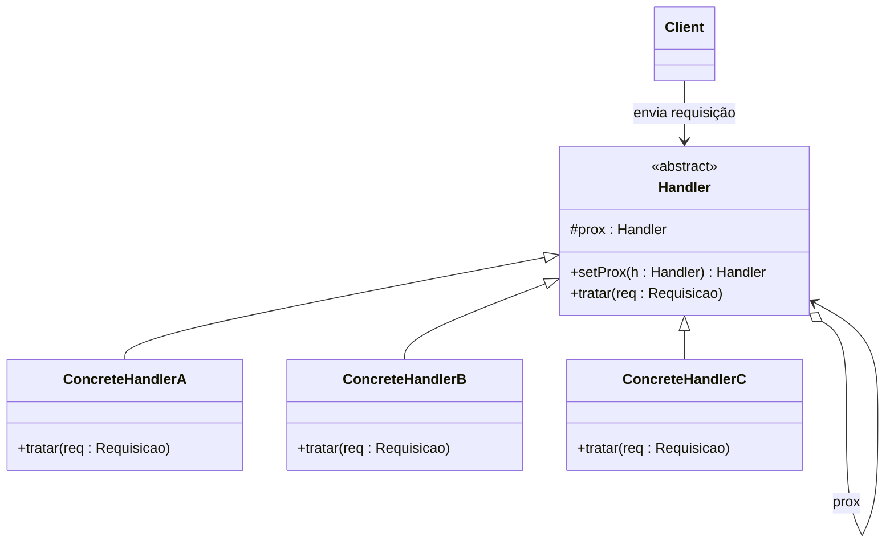
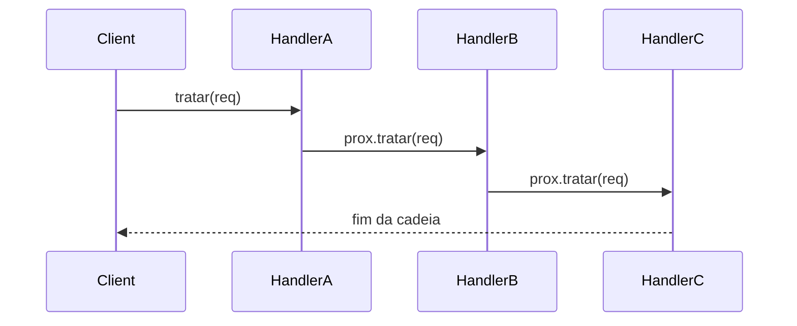

# Chain of Responsibility

**Categoria:** comportamental

## O que é

O Chain of Responsibility passa uma requisição por uma **cadeia de objetos (handlers)**. Cada handler decide se trata a requisição, se repassa para o próximo da cadeia, ou as duas coisas.

Assim, quem envia a requisição não precisa saber qual objeto vai tratá-la. Ele conhece só o primeiro elo.

## Quando usar

- Quando mais de um objeto pode tratar uma requisição e o responsável só é conhecido em tempo de execução.
- Quando o processamento é feito em **etapas sequenciais** (validação → autenticação → pagamento...).
- Quando a ordem ou a quantidade de etapas precisa mudar sem alterar o código do cliente.

## Participantes

- **Handler:** interface ou classe abstrata. Guarda a referência ao próximo (`prox`) e define o método de tratamento.
- **ConcreteHandler:** trata o que é da sua responsabilidade e chama o próximo quando precisa.
- **Client:** monta a cadeia e envia a requisição para o primeiro handler.

## UML

Fluxo de uma requisição:

## Vantagens e desvantagens

| Vantagens | Desvantagens |
|---|---|
| Desacopla quem envia de quem trata | Não há garantia de que alguém trate a requisição |
| É fácil adicionar, remover ou reordenar etapas | Depurar uma cadeia longa pode ser difícil |
| Cada handler tem uma única responsabilidade | |

## Exercícios desta pasta

| Exercício | Handler | Handlers concretos |
|---|---|---|
| [dispensadora_cedulas_atm](dispensadora_cedulas_atm) | `Cedula` | instâncias de `Cedula` (50 → 20 → 10) |
| [processamento_pedidos_ecommerce](processamento_pedidos_ecommerce) | `ProcessamentoPedido` | `Estoque`, `Descontos`, `Frete`, `Pagamento` |
| [processo_seletivo_simplificado_pps](processo_seletivo_simplificado_pps) | `Prova` | `Titulo`, `ExpEnsino`, `GestaoAcademica`, `Desempenho` |
| [suporte_tecnico](suporte_tecnico) | `SuporteTecnicoHandler` | `SuporteHardware`, `SuporteRede`, `SuporteSoftware`, `SuporteTI` |

> O exercício [processamento_transacoes_pagamento](../Strategy/processamento_transacoes_pagamento), na pasta **Strategy**, também usa uma cadeia (`TransacaoHandler`: `ValidacaoDadosTransacao` → `AutenticacaoUsuario` → `ProcessamentoPagamento` → `EnvioRecibo`).
