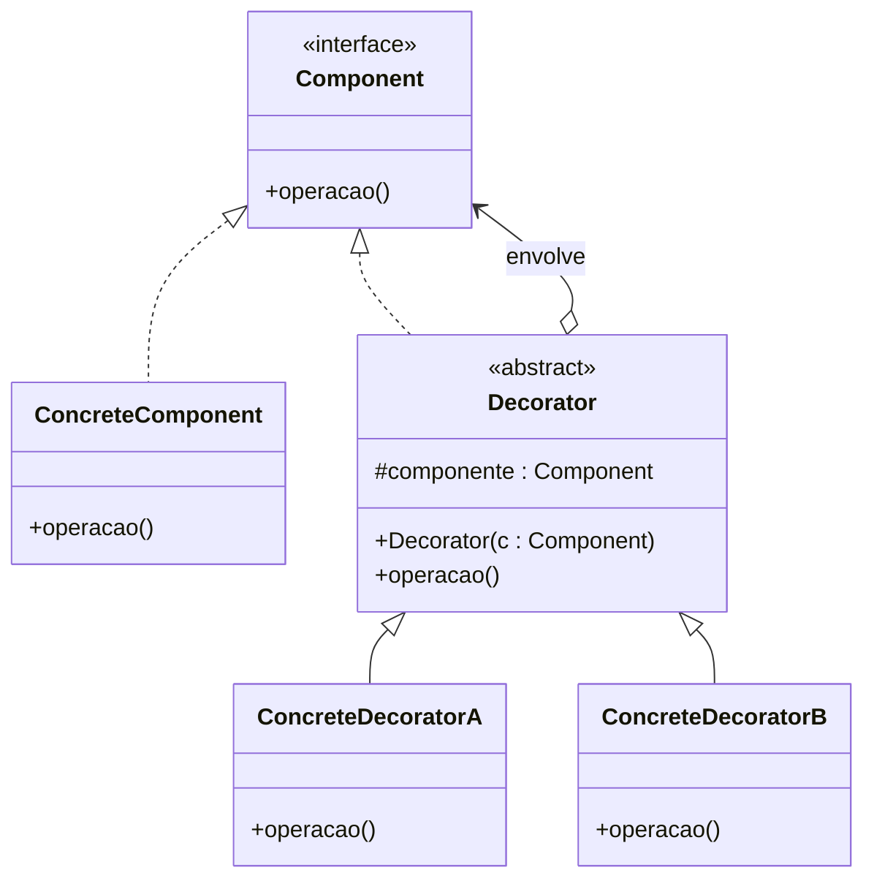

# Decorator

**Categoria:** estrutural

## O que é

O Decorator **adiciona responsabilidades a um objeto dinamicamente**, envolvendo-o em outro objeto que tem a mesma interface.

Cada decorador guarda uma referência para o objeto que ele decora. Ele repassa a chamada e acrescenta algo antes ou depois. Como o decorador tem a mesma interface do componente, é possível empilhar vários decoradores (por exemplo, cupom de desconto + taxa de embalagem + frete).

## Quando usar

- Quando é preciso adicionar comportamentos a objetos sem mudar a classe deles.
- Quando as combinações de comportamentos são muitas e criar uma subclasse para cada uma geraria uma "explosão de classes".
- Quando os comportamentos devem poder ser adicionados ou removidos em tempo de execução.

## Participantes

- **Component:** interface comum ao objeto original e aos decoradores.
- **ConcreteComponent:** o objeto original, que será decorado.
- **Decorator:** classe abstrata que implementa `Component` e guarda uma referência para outro `Component`.
- **ConcreteDecorator:** acrescenta o comportamento extra.

## UML



Exemplo de empilhamento:

```java
Component c = new ConcreteDecoratorB(new ConcreteDecoratorA(new ConcreteComponent()));
c.operacao(); // B -> A -> componente original
```

## Vantagens e desvantagens

| Vantagens | Desvantagens |
|---|---|
| Mais flexível que herança | Muitos objetos pequenos e parecidos |
| As combinações são montadas em tempo de execução | A ordem dos decoradores pode mudar o resultado |
| Cada decorador tem uma única responsabilidade | Fica difícil remover um decorador do meio da pilha |

## Exercícios desta pasta

| Exercício | Component | ConcreteComponent | Decorator | Decoradores concretos |
|---|---|---|---|---|
| [frete_decorator](frete_decorator) | `Pedido` | `Carrinho` | `AjustePedido` | `CupomDesconto`, `TaxaEmbalagem`, `CalculadoraFrete` (`SedexFrete`, `UberFrete`) |
| [text_decorator](text_decorator) | `ElementoVisual` | `VisualizadorTexto` | `DecoradorBase` | `Borda`, `ScrollBar` (Swing) |

> O `frete_decorator` também tem o diagrama de classes do exercício em [diagrama de classes/decorator.svg](frete_decorator/diagrama%20de%20classes/decorator.svg).
