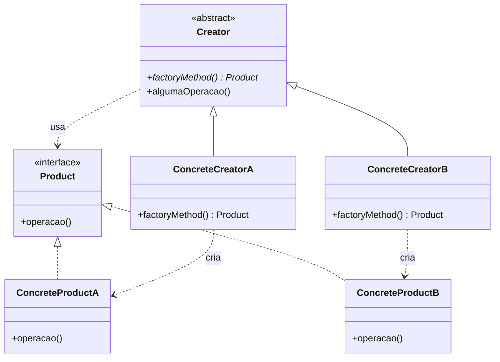

# Factory Method

**Categoria:** criacional

## O que é

O Factory Method define um **método para criar objetos** em uma superclasse, mas deixa as **subclasses decidirem qual classe concreta instanciar**.

A superclasse (o **criador**) trabalha só com a interface do produto. Ela chama o factory method quando precisa de um objeto e não sabe qual classe concreta foi criada.

## Quando usar

- Quando uma classe não sabe de antemão quais objetos vai precisar criar.
- Quando se quer que as subclasses escolham o tipo do objeto criado.
- Quando se quer adicionar novos produtos sem mexer no código que os usa (princípio Aberto/Fechado).

## Participantes

- **Product:** interface dos objetos criados.
- **ConcreteProduct:** implementações do produto.
- **Creator:** classe abstrata que declara o factory method (`criar...()`) e tem a lógica que usa o produto.
- **ConcreteCreator:** sobrescreve o factory method e devolve um `ConcreteProduct`.

## UML

## Factory Method x Simple Factory

- No **Simple Factory**, uma única classe decide o que criar, normalmente com um `switch`. Para um produto novo, é preciso alterar a fábrica.
- No **Factory Method**, a decisão fica nas subclasses, por herança. Para um produto novo, basta criar um produto e um criador novos, sem alterar o que já existe.

## Vantagens e desvantagens

| Vantagens | Desvantagens |
|---|---|
| O criador não depende das classes concretas | Cada produto novo pede um criador novo |
| Respeita o princípio Aberto/Fechado | Aumenta o número de classes |
| A criação fica em um único lugar | |

## Exercícios desta pasta

| Exercício | Creator | Factory method | Criadores concretos | Product | Produtos concretos |
|---|---|---|---|---|---|
| [processamento_transacao_factory](processamento_transacao_factory) | `Transacao` | `criarFormaPagamento()` | `TransacaoBoleto`, `TransacaoPix`, `TransacaoCredito` | `Pagamento` | `Boleto`, `Pix`, `CartaoDeCredito` |

Esse exercício também usa o **Template Method**: `Transacao.processar()` define a ordem validação → autenticação → pagamento → recibo. Veja a pasta [Template_Method](../Template_Method).
