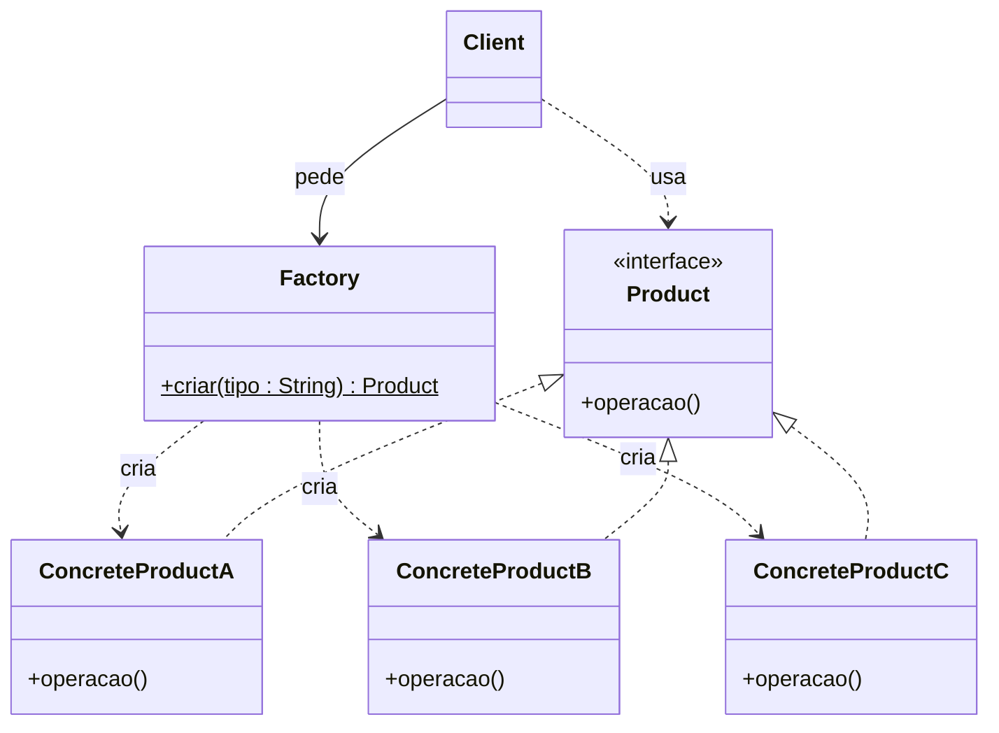

# Simple Factory

**Categoria:** criacional (é uma prática muito usada, mas não é um dos 23 padrões do livro do GoF)

## O que é

O Simple Factory coloca a **criação de objetos em uma única classe (a fábrica)**. Normalmente ela tem um método estático que recebe um parâmetro (um tipo ou código) e devolve o objeto concreto certo.

O cliente pede o objeto à fábrica e não usa `new` nas classes concretas. Assim, ele depende só da interface do produto.

## Quando usar

- Quando a criação de um objeto depende de um parâmetro (`"sms"`, `"email"`, código `0/1/2`...).
- Quando o mesmo `switch` de criação aparece em vários lugares do código.
- Quando há poucos tipos de produto e eles mudam pouco. Se mudarem muito, considere o [Factory Method](../Factory_Method).

## Participantes

- **Factory:** tem o método de criação, com a lógica de escolha.
- **Product:** interface ou classe abstrata dos objetos criados.
- **ConcreteProduct:** as implementações.
- **Client:** pede o produto à fábrica.

## UML

## Vantagens e desvantagens

| Vantagens | Desvantagens |
|---|---|
| A criação fica em um só lugar | Um produto novo obriga a alterar a fábrica (fere o Aberto/Fechado) |
| O cliente não depende das classes concretas | A fábrica pode virar um `switch` enorme |
| Simples de entender e implementar | |

## Exercícios desta pasta

| Exercício | Fábrica | Product | Produtos concretos |
|---|---|---|---|
| [simple_factory_notification](simple_factory_notification) | `NotificationFactory.createNotification(tipo)` | `Notification` | `SMSNotification`, `PushNotification`, `EmailNotification` |
| [refactoring_example_locadora](refactoring_example_locadora) | `ClassificacaoFactory.criarClassificacao(codigo)` | `Classificacao` | `Basica`, `Familia`, `Luxo` |

O `refactoring_example_locadora` é um exercício de refatoração (GRASP). Além da fábrica, ele:
- troca o `switch` do preço por polimorfismo nas classes de `Classificacao`, numa ideia parecida com o [Strategy](../Strategy);
- separa a geração do extrato em `GeradorExtrato`, com as versões `Extrato` (texto) e `ExtratoHTML`.
