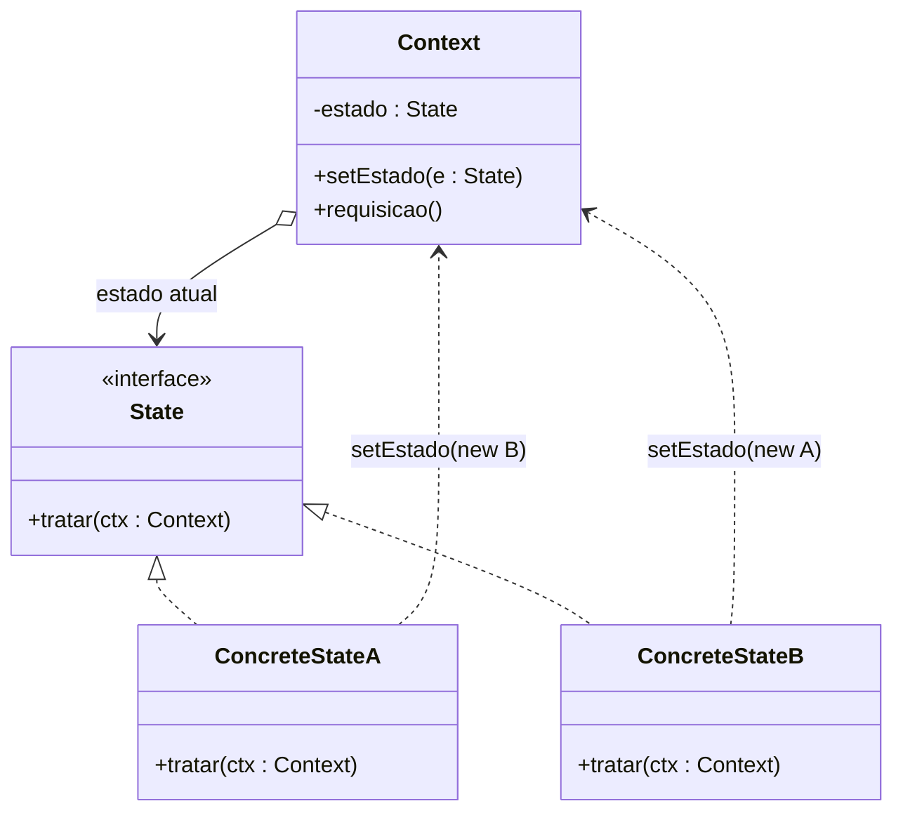
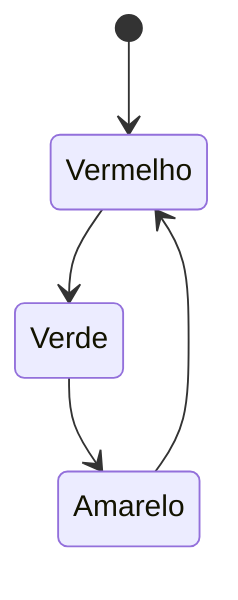

# State

**Categoria:** comportamental

## O que é

O State permite que um objeto **mude de comportamento quando o seu estado interno muda**. Parece que o objeto trocou de classe.

Em vez de vários `if`/`switch` verificando o estado atual, cada estado vira uma classe. O objeto principal (o **contexto**) guarda uma referência para o estado atual e delega a ele as chamadas. Os próprios estados decidem qual é o próximo estado.

## Quando usar

- Quando o comportamento de um objeto depende do seu estado e muda em tempo de execução.
- Quando há muitos condicionais grandes que testam o estado atual.
- Quando o problema é uma **máquina de estados** (semáforo, fluxo de pedido, máquina de Turing...).

## Participantes

- **Context:** a classe usada pelo cliente. Guarda o estado atual e delega as operações para ele.
- **State:** interface ou classe abstrata com as operações que dependem do estado.
- **ConcreteState:** implementa o comportamento de um estado e faz a transição chamando `context.setEstado(...)`.

## UML

Exemplo de transições (semáforo):

## State x Strategy

Os dois diagramas são parecidos. A diferença está na intenção:

- No **State**, os estados se conhecem e fazem as transições sozinhos. O cliente normalmente não escolhe o estado.
- No **Strategy**, o cliente escolhe a estratégia, e as estratégias não sabem umas das outras.

## Vantagens e desvantagens

| Vantagens | Desvantagens |
|---|---|
| Remove condicionais grandes sobre o estado | Cria muitas classes pequenas |
| Cada estado fica isolado na sua classe (responsabilidade única) | É exagero quando há poucos estados ou eles quase não mudam |
| É fácil adicionar novos estados | |

## Exercícios desta pasta

| Exercício | Contexto | Estados |
|---|---|---|
| [monitoramento_envio_pedido](monitoramento_envio_pedido) | `Pedido` | `Preparacao`, `Recebido`, `TransportadoraEstado`, `Finalizado` |
| [quiosque_inscricao_incompleto](quiosque_inscricao_incompleto) | `Quiosque` | `EmEspera` (exercício incompleto) |
| [semaforo](semaforo) | `Semaforo` | `Verde`, `Amarelo`, `Vermelho` |
| [turing_machine](turing_machine) | `Maquina` | `A`, `B`, `Halt` |
