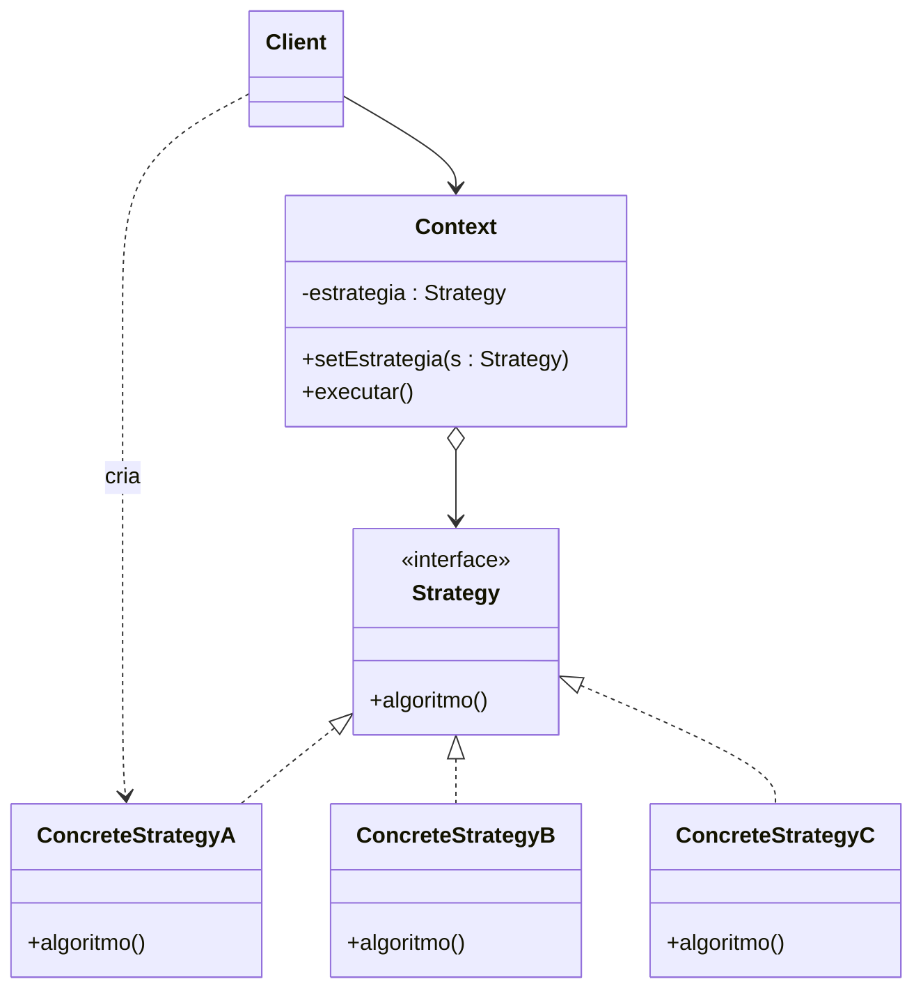

# Strategy

**Categoria:** comportamental

## O que é

O Strategy define uma **família de algoritmos**, coloca cada um na sua própria classe e os torna **intercambiáveis**.

O objeto que usa o algoritmo (o **contexto**) depende só da interface da estratégia. Assim é possível trocar o algoritmo, até em tempo de execução, sem mudar o contexto.

## Quando usar

- Quando existem várias formas de fazer a mesma coisa (formas de pagamento, cálculos de preço, ordenações...).
- Quando há um `if`/`switch` grande escolhendo o comportamento.
- Quando o cliente precisa escolher ou trocar o comportamento em tempo de execução.

## Participantes

- **Strategy:** interface comum a todos os algoritmos.
- **ConcreteStrategy:** cada implementação de um algoritmo.
- **Context:** guarda uma referência para uma `Strategy` e a usa sem saber qual é a classe concreta.
- **Client:** cria a estratégia concreta e a entrega ao contexto.

## UML

## Vantagens e desvantagens

| Vantagens | Desvantagens |
|---|---|
| Troca o algoritmo em tempo de execução | O cliente precisa conhecer as estratégias para escolher uma |
| Substitui condicionais por polimorfismo | Aumenta o número de classes |
| Respeita o princípio Aberto/Fechado | |

## Exercícios desta pasta

| Exercício | Contexto | Strategy | Estratégias concretas |
|---|---|---|---|
| [processamento_transacoes_pagamento](processamento_transacoes_pagamento) | `ProcessamentoPagamento` | `FormaDePagamento` | `Boleto`, `CartaoDeCredito`, `Pix` |

Esse exercício também usa o **Chain of Responsibility** (pacote `transacao_chain`). Um dos elos da cadeia, `ProcessamentoPagamento`, recebe a estratégia de pagamento no construtor.

> O exercício [refactoring_example_locadora](../Simple_Factory/refactoring_example_locadora), na pasta **Simple Factory**, tem uma ideia parecida: o cálculo do valor da locação varia conforme a `Classificacao` (`Basica`, `Familia`, `Luxo`) do automóvel.
