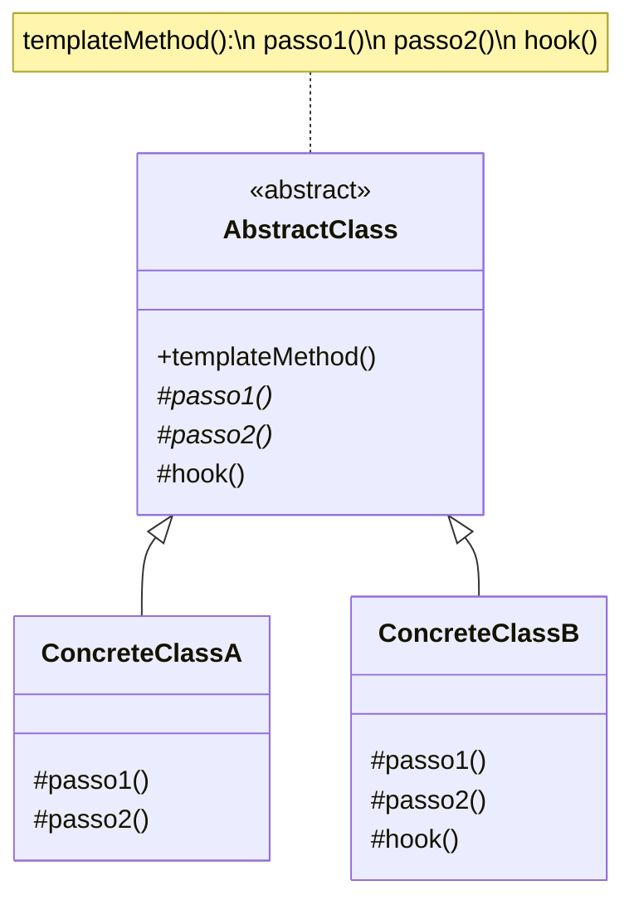

# Template Method

**Categoria:** comportamental

## O que é

O Template Method define o **esqueleto de um algoritmo** em um método da superclasse e deixa as subclasses implementarem alguns passos, sem mudar a ordem desses passos.

A superclasse controla o fluxo ("primeiro faz X, depois Y, depois Z"). As subclasses só preenchem os detalhes de cada passo.

## Quando usar

- Quando várias classes seguem o mesmo algoritmo e só alguns passos mudam.
- Quando se quer evitar código duplicado entre classes parecidas.
- Quando a ordem dos passos não pode ser alterada pelas subclasses.

## Participantes

- **AbstractClass:** tem o **template method** (o esqueleto, de preferência `final`) e declara os passos abstratos. Também pode ter passos com implementação padrão (hooks).
- **ConcreteClass:** implementa os passos abstratos.

## UML

## Vantagens e desvantagens

| Vantagens | Desvantagens |
|---|---|
| Reaproveita o código comum na superclasse | Usa herança, então o acoplamento é maior que na composição |
| Garante a ordem dos passos | Mudar o esqueleto afeta todas as subclasses |
| Fácil criar uma nova variação | Muitos passos abstratos deixam as subclasses trabalhosas |

## Exercícios desta pasta

| Exercício | Classe abstrata | Template method | Passos | Classes concretas |
|---|---|---|---|---|
| [social_network_template](social_network_template) | `SocialNetwork` | `post()` | `login()`, `sendData()`, `logout()` | `Facebook`, `Twitter` |

> O exercício [processamento_transacao_factory](../Factory_Method/processamento_transacao_factory), na pasta **Factory Method**, também usa um template method: `Transacao.processar()` (validação → autenticação → pagamento → recibo).
